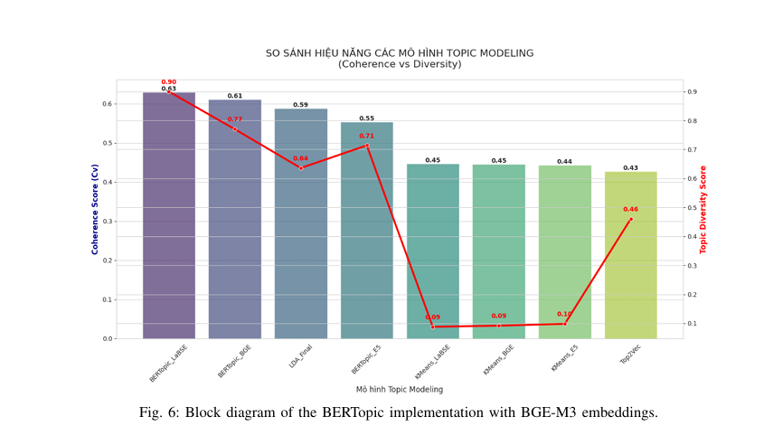
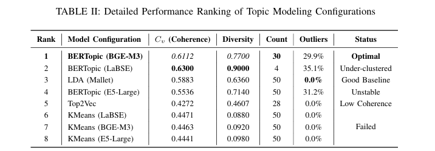
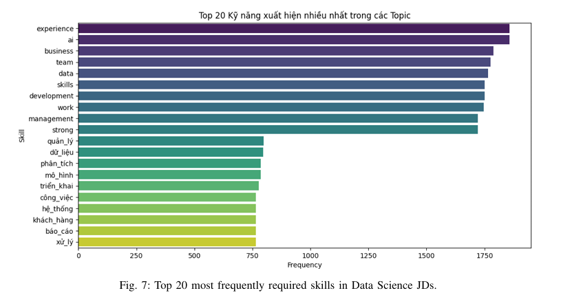
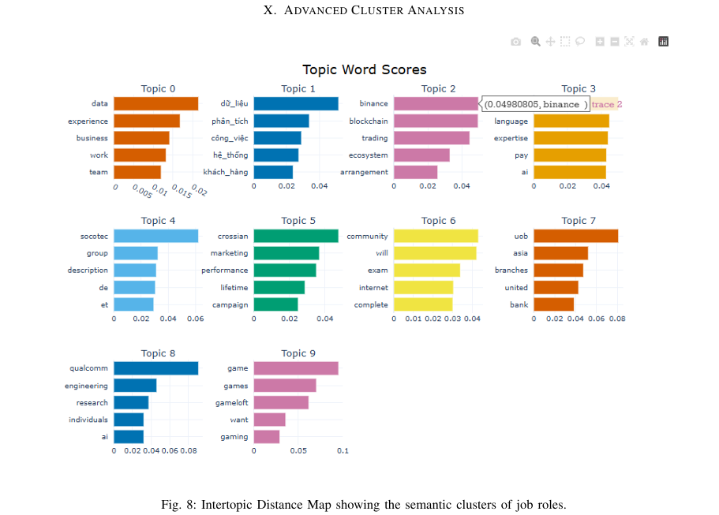

# Vietnam Data Science Job Market Analysis

**Phân tích thị trường tuyển dụng ngành Data Science tại Việt Nam bằng NLP và Topic Modeling**

## 1. Giới thiệu

Dự án phân tích thị trường tuyển dụng trong các lĩnh vực Data Science, Data Analyst và Machine Learning Engineer tại Việt Nam. Dữ liệu được thu thập từ nhiều nền tảng tuyển dụng, sau đó được hợp nhất, làm sạch và xử lý bằng các kỹ thuật Natural Language Processing (NLP).

Dự án thử nghiệm nhiều phương pháp Topic Modeling nhằm khám phá các nhóm kỹ năng được yêu cầu trong tin tuyển dụng, phân tích mức độ phổ biến của kỹ năng và so sánh chất lượng giữa các mô hình.

**Mục tiêu chính:**
- Khám phá các kỹ năng được nhà tuyển dụng yêu cầu.
- Xác định các nhóm chủ đề kỹ năng từ mô tả công việc.
- Phân tích nhu cầu tuyển dụng trong lĩnh vực Data tại Việt Nam.
- So sánh các mô hình Topic Modeling sử dụng những phương pháp biểu diễn văn bản khác nhau.

## 2. Thành viên thực hiện

- Nguyễn Hoàng Anh
- Hà Thế Anh
- Bạch Quang Tùng

## 3. Dữ liệu

### 3.1. Quy mô dữ liệu

- **3.125 tin tuyển dụng** được thu thập và tổng hợp phục vụ nghiên cứu.
- **5 nền tảng tuyển dụng:** VietnamWorks, LinkedIn, TopCV, ITviec và JobOKO.
- Dữ liệu tập trung vào các vị trí Data Science, Data Analyst và Machine Learning Engineer.

> **Lưu ý:** 3.125 là quy mô dữ liệu ghi nhận trong dự án, không đại diện cho tổng số tin tuyển dụng trên toàn thị trường Việt Nam.

### 3.2. Nguồn dữ liệu

| Nền tảng | Dữ liệu sử dụng |
|---|---|
| VietnamWorks | Danh sách việc làm, mô tả công việc và kỹ năng |
| LinkedIn | Dữ liệu tin tuyển dụng |
| TopCV | Dữ liệu tin tuyển dụng |
| ITviec | Dữ liệu tin tuyển dụng |
| JobOKO | Dữ liệu tin tuyển dụng |

Dữ liệu được lưu dưới định dạng CSV và Excel trong thư mục `Datasets/`.

## 4. Quy trình thực hiện

### Bước 1. Thu thập dữ liệu

**Notebook:** `Code/Step0_VietnamworksCrawl.ipynb`

Sử dụng Python để thu thập thông tin tuyển dụng từ VietnamWorks, bao gồm danh sách công việc, mô tả công việc và kỹ năng yêu cầu. Dữ liệu được lưu thành CSV để phục vụ các bước xử lý tiếp theo.

### Bước 2. Hợp nhất dữ liệu

**Notebook:** `Code/Step0_CombineDataset.ipynb`

- Hợp nhất dữ liệu từ nhiều nền tảng tuyển dụng.
- Chuẩn hóa cấu trúc và các trường thông tin.
- Xử lý dữ liệu trùng lặp.
- Chuẩn bị bộ dữ liệu thống nhất cho quá trình phân tích.

### Bước 3. Tiền xử lý văn bản

**Notebook:** `Code/Step1_Preprocessing.ipynb`

Các bước xử lý NLP:
- Làm sạch dữ liệu và loại bỏ ký tự không cần thiết.
- Chuẩn hóa văn bản trong mô tả công việc.
- Tokenization.
- Loại bỏ stopwords.
- Chuẩn hóa tên kỹ năng và nội dung văn bản.

Mục tiêu là giảm nhiễu trong dữ liệu đầu vào và cải thiện chất lượng biểu diễn văn bản trước khi xây dựng mô hình.

### Bước 4. Topic Modeling

**Notebook:** `Code/Step2_TopicModeling.ipynb`

Dự án thử nghiệm các phương pháp sau:

| Mô hình | Phương pháp |
|---|---|
| BERTopic + Multilingual E5-Large | Biểu diễn văn bản bằng `multilingual-e5-large`, sau đó khám phá chủ đề bằng BERTopic |
| BERTopic + BGE | Sử dụng embedding BGE kết hợp BERTopic |
| BERTopic + LaBSE | Sử dụng embedding LaBSE kết hợp BERTopic |
| Top2Vec | Khám phá chủ đề dựa trên biểu diễn ngữ nghĩa của văn bản |

Các mô hình được sử dụng để khám phá những nhóm chủ đề tiềm ẩn trong mô tả công việc và nội dung kỹ năng.

**Tiêu chí đánh giá:**
- Khả năng tạo ra các chủ đề có ý nghĩa.
- Mức độ đa dạng giữa các chủ đề.
- Chất lượng từ khóa đại diện cho từng chủ đề.
- Khả năng biểu diễn nội dung tuyển dụng.

### Bước 5. Trực quan hóa và phân tích

**Notebook:** `Code/Step3_Visualization.ipynb`

Các nội dung phân tích và trực quan hóa gồm:

- **Topic Distribution:** Phân bố tin tuyển dụng theo chủ đề.
- **Topic Frequency:** Tần suất xuất hiện của các chủ đề.
- **Word Importance:** Mức độ quan trọng của từ khóa.
- **Topic Relationship:** Mối quan hệ giữa các chủ đề.
- **Skill Analysis:** Phân tích nhóm kỹ năng được đề cập.
- **Demand Analysis:** Khám phá nhu cầu tuyển dụng theo các nhóm chủ đề.

## 5. Kết quả trực quan hóa

### 5.1. So sánh hiệu năng các mô hình Topic Modeling



Biểu đồ so sánh Topic Coherence và Topic Diversity giữa các cấu hình mô hình được thử nghiệm. Kết quả cho thấy các mô hình có sự khác biệt về mức độ nhất quán của chủ đề và độ đa dạng từ khóa.

### 5.2. Bảng xếp hạng đánh giá mô hình



Bảng tổng hợp các chỉ số đánh giá của từng cấu hình, bao gồm Coherence, Diversity, số lượng chủ đề và tỷ lệ outliers.

Theo bảng kết quả trong báo cáo:

- **BERTopic (BGE-M3):** Coherence = 0,6112; Diversity = 0,7700; được xếp hạng 1.
- **BERTopic (LaBSE):** Coherence = 0,6300; Diversity = 0,9000; được ghi chú là *Under-clustered*.
- **LDA (Mallet):** Coherence = 0,5883; Diversity = 0,6360; được ghi chú là *Good Baseline*.
- **BERTopic (E5-Large):** Coherence = 0,5536; Diversity = 0,7140; được ghi chú là *Unstable*.
- **Top2Vec:** Coherence = 0,4272; Diversity = 0,4607; được ghi chú là *Low Coherence*.

Các kết quả cho thấy không nên lựa chọn mô hình chỉ dựa trên một chỉ số. Cần xem xét đồng thời coherence, diversity, số lượng chủ đề, outliers và khả năng diễn giải kết quả.

### 5.3. Top 20 kỹ năng xuất hiện nhiều nhất



Biểu đồ thể hiện 20 kỹ năng xuất hiện thường xuyên nhất trong dữ liệu tuyển dụng sau quá trình xử lý.

Trong biểu đồ, các từ khóa nổi bật gồm `experience`, `AI`, `business`, `team`, `data`, `skills`, `development`, `work` và `management`. Một số từ khóa tiếng Việt như `quản_lý`, `dữ_liệu` và `phân_tích` cũng xuất hiện trong danh sách.

Kết quả giúp nhận diện những nhóm kỹ năng và yêu cầu thường được đề cập trong dữ liệu tuyển dụng được thu thập.

### 5.4. Từ khóa đại diện theo chủ đề



Biểu đồ thể hiện các từ khóa có điểm số nổi bật trong từng chủ đề được phát hiện. Các từ khóa này hỗ trợ diễn giải nội dung và nhận diện đặc điểm ngữ nghĩa của từng nhóm tin tuyển dụng.

Các chủ đề hiển thị trong hình có nội dung đa dạng, bao gồm dữ liệu và phân tích, tài chính, blockchain, ngân hàng, kỹ thuật và trò chơi. Do dữ liệu được tổng hợp từ nhiều nguồn và các nhóm nghề nghiệp, cần xem xét từ khóa cùng ngữ cảnh trước khi gán ý nghĩa cụ thể cho từng chủ đề.

## 6. Đánh giá mô hình

Báo cáo đánh giá được lưu tại:

`Results/complete_model_evaluation_report.csv`

Các chỉ số đánh giá gồm:

| Chỉ số | Ý nghĩa |
|---|---|
| Topic Coherence | Đánh giá mức độ liên quan giữa các từ khóa trong cùng một chủ đề |
| Topic Diversity | Đánh giá mức độ đa dạng của từ khóa giữa các chủ đề |
| Topic Quality | Chỉ số đánh giá chất lượng chủ đề theo phương pháp được triển khai trong dự án |
| Topic Representation | Đánh giá khả năng đại diện của các từ khóa đối với chủ đề |

Việc sử dụng nhiều chỉ số giúp so sánh mô hình từ các góc độ khác nhau thay vì chỉ dựa trên một tiêu chí duy nhất.

**Lưu ý về kết quả:** Bảng xếp hạng và biểu đồ so sánh được trích từ hình báo cáo đã cung cấp. Trước khi công bố, nên đối chiếu lại các con số với `complete_model_evaluation_report.csv` để bảo đảm chúng thống nhất.

## 7. Kết quả và giá trị đạt được

- Tổng hợp dữ liệu tuyển dụng từ 5 nền tảng thành bộ dữ liệu phục vụ phân tích, với quy mô ghi nhận là 3.125 tin.
- Xây dựng quy trình tiền xử lý văn bản cho dữ liệu tuyển dụng.
- Thử nghiệm các phương pháp Topic Modeling sử dụng BERTopic với nhiều embedding và Top2Vec.
- Tổng hợp kết quả đánh giá mô hình bằng các chỉ số Topic Coherence, Topic Diversity, Topic Quality và Topic Representation.
- Trực quan hóa phân bố chủ đề, tần suất chủ đề, từ khóa quan trọng và các nhóm kỹ năng.
- Tạo cơ sở để khám phá nhóm kỹ năng và nhu cầu tuyển dụng trong các lĩnh vực Data tại Việt Nam.

Dự án thể hiện việc ứng dụng Python, NLP và các phương pháp khám phá chủ đề vào bài toán phân tích dữ liệu tuyển dụng.

## 8. Công nghệ sử dụng

| Nhóm | Công nghệ |
|---|---|
| Ngôn ngữ | Python |
| Xử lý dữ liệu | Pandas, NumPy, OpenPyXL |
| Machine Learning | Scikit-learn |
| NLP | Tokenization, Stopwords Removal, Text Preprocessing |
| Topic Modeling | BERTopic, Top2Vec |
| Embedding Models | Multilingual E5-Large, BGE, LaBSE |
| Sentence Embeddings | Sentence Transformers |
| Trực quan hóa | Matplotlib, Seaborn, Plotly |
| Môi trường phát triển | Jupyter Notebook |

## 9. Cấu trúc thư mục

```text
Project_Phan_Tich_Nghe_Nghiep/
│
├── Code/
│   ├── Step0_VietnamworksCrawl.ipynb
│   ├── Step0_CombineDataset.ipynb
│   ├── Step1_Preprocessing.ipynb
│   ├── Step2_TopicModeling.ipynb
│   └── Step3_Visualization.ipynb
│
├── Datasets/
│   ├── vietnamworks_jobs_detail.csv
│   ├── TopCV_Data.xlsx
│   ├── data_science_jobs.xlsx
│   ├── data_web_itviec.xlsx
│   ├── joboko_phan_loai.xlsx
│   └── data_linkedin.xlsx
│
├── Results/
│   ├── complete_model_evaluation_report.csv
│   ├── topic_model_comparison.png
│   ├── topic_model_evaluation_ranking.png
│   ├── top_20_required_skills.png
│   └── topic_word_scores.png
│
└── README.md
```

> Tên notebook, dữ liệu và hình ảnh trong sơ đồ cần khớp với tên thực tế trong repository. Các tên hình ở trên tương ứng với bốn hình minh họa được đề xuất cho README.

## 10. Hướng phát triển

- Xây dựng dashboard Power BI để theo dõi nhu cầu kỹ năng.
- Mở rộng dữ liệu và cập nhật định kỳ để theo dõi biến động thị trường.
- Phân tích sâu hơn theo vị trí công việc, cấp độ kinh nghiệm và nhóm kỹ năng.
- Kết hợp các chỉ số định lượng với đánh giá thủ công về tính hợp lý của chủ đề.
- Phát triển hệ thống gợi ý kỹ năng học tập dựa trên yêu cầu tuyển dụng.

## 11. Kỹ năng thể hiện

- Data Collection và Data Integration.
- Data Cleaning và Text Preprocessing.
- Exploratory Data Analysis (EDA).
- Python và Pandas.
- Natural Language Processing (NLP).
- Sentence Embeddings và Topic Modeling.
- Model Evaluation.
- Data Visualization.
- Phân tích và diễn giải dữ liệu tuyển dụng.

---

**Project focus:** Data Analysis · Natural Language Processing · Topic Modeling · Job Market Insights
"""
